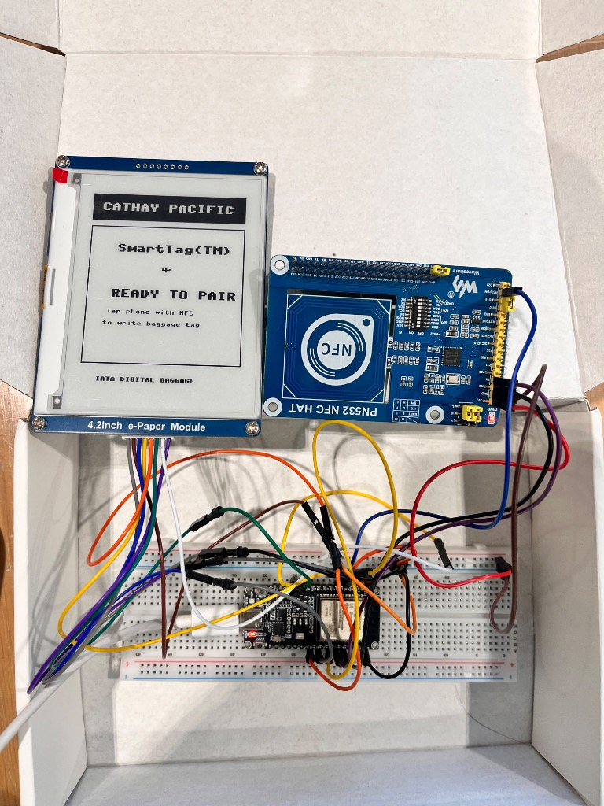
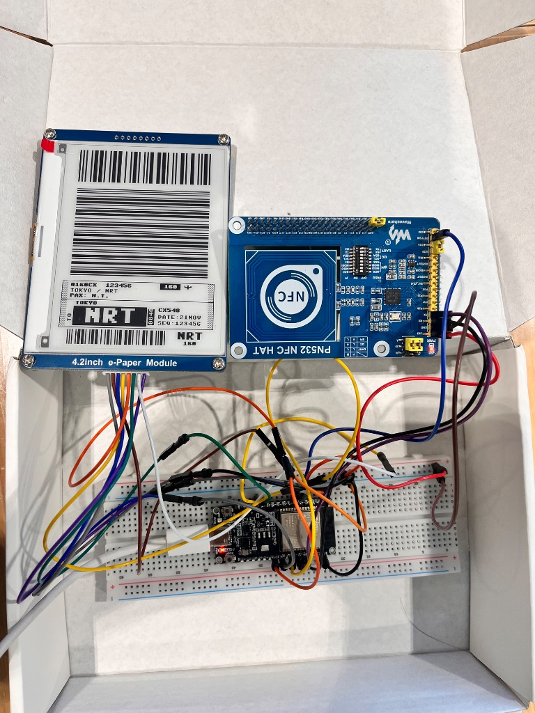

# Baggage Recovery Copilot

**Cathay Hackathon 2026 submission** - a reusable digital baggage identity and
ground-operations prototype. This is an independent PolyAero concept, not an
official Cathay Pacific product or a production airline system.

**Naming:** Baggage Recovery Copilot is the project name; SmartTag refers to the
physical NFC/e-paper tag. Repository URLs, APK filenames, API paths, package names,
and protocol identifiers retain their legacy names for compatibility.

## Demo and release links

- [Hosted operations portal](https://cathay.haidangtrih.me/#transfer-control)
- [Android APK release v1.0.0](https://github.com/lighthouse16/polyaero-cathay-smarttag/releases/tag/v1.0.0)
- [Hardware specifications and pinout](docs/hardware/README.md)
- [Standalone MicroPython firmware](apps/firmware/micropython-esp32c6/README.md)

## What the project does

- **Passenger app:** Expo / React Native app with member sign-in, flight search,
  bookings, trips, staff-reported flight status, and prototype boarding passes.
- **SmartTag:** NFC baggage identity, sync/readback logic, and a simulated journey
  experience. Native NFC requires a development build and compatible hardware.
- **Staff dashboard:** Next.js operations workspace for baggage visibility,
  custody scans, model risk assessments, recovery choices, and a streaming
  Baggage Recovery Copilot with optional server-configured model providers.
- **Backend:** FastAPI, SQLAlchemy, and Alembic with PostgreSQL. Bookings and
  baggage reference a shared flight catalogue; events and operational updates
  persist in the database.
- **Hardware prototype:** ESP32-C6, PN532, and a Waveshare 4.2-inch e-paper display
  running standalone MicroPython firmware.

## Hosted API

| Resource                      | URL                                                               |
| ----------------------------- | ----------------------------------------------------------------- |
| API base                      | https://smarttag-demo-4pu4shawla-df.a.run.app/api/v1              |
| Interactive API documentation | https://smarttag-demo-4pu4shawla-df.a.run.app/api/v1/docs         |
| OpenAPI schema                | https://smarttag-demo-4pu4shawla-df.a.run.app/api/v1/openapi.json |
| Service health                | https://smarttag-demo-4pu4shawla-df.a.run.app/health              |

The API is hosted on **Google Cloud Run**; its data is stored in **AWS RDS
PostgreSQL**, not in the Cloud Run container. This is a temporary hackathon
service: availability and demo data may change. Member endpoints require
sign-in. The health endpoint reports service health, not a database readiness
guarantee. Use synthetic data only; do not submit real passenger information.

To point a local frontend at the hosted service, set its API variable to the
base URL above: `EXPO_PUBLIC_API_URL` for mobile or `NEXT_PUBLIC_API_URL` for
staff. Restart the development server after changing environment values.
Standalone mobile builds must be rebuilt when their API URL changes.

## Repository layout

```text
apps/
  api/                         FastAPI, PostgreSQL models, migrations, seeds
  mobile/                      Expo passenger app and native NFC services
  staff/                       Next.js ground-operations dashboard
  firmware/micropython-esp32c6/ Standalone PN532 / e-paper firmware
packages/
  shared/                      Domain contracts, NFC simulation, fixtures
  design-tokens/               Shared colors, typography, and layout tokens
docs/                          Architecture, development, and hardware notes
tests/maestro/                 Mobile smoke-test flows
.github/                       CI and contribution templates
```

## Run locally

### Prerequisites

- Node.js 22 (the CI baseline) and pnpm 10.33.0.
- Python 3.13 (matching the API container) and [uv](https://docs.astral.sh/uv/).
- PostgreSQL 16+ running locally, or Docker to start an isolated development DB.
- For physical NFC: Android tooling, a compatible phone, and an Expo development
  build. Browser/Expo Go testing does not verify native NFC or e-paper refresh.

The following commands use **PowerShell**, starting at the repository root.
On macOS/Linux, use `cp` instead of `Copy-Item`, `cd` instead of `Set-Location`,
and the corresponding shell path separators. Run the three servers in separate
terminals.

### 1. Install frontend dependencies and configure environments

```powershell
pnpm install --frozen-lockfile
Copy-Item apps\mobile\.env.example apps\mobile\.env
Copy-Item apps\staff\.env.example apps\staff\.env.local
Copy-Item apps\api\.env.example apps\api\.env
```

Do not overwrite an existing configured environment file. The root
`.env.example` is a reference only; each application loads its own file.
Never put database credentials, signing keys, SMTP passwords, or device/staff
keys in `EXPO_PUBLIC_*` or `NEXT_PUBLIC_*`: those values reach client bundles.

### 2. Start PostgreSQL

If you already have PostgreSQL, create an empty `smarttag` database and set
`DATABASE_URL` in `apps\api\.env` to match your local credentials.
Alternatively, start a dedicated local Docker database:

```powershell
docker run --name polyaero-postgres -e POSTGRES_USER=postgres -e POSTGRES_PASSWORD=postgres -e POSTGRES_DB=smarttag -p 127.0.0.1:5432:5432 -v polyaero-postgres-data:/var/lib/postgresql/data -d postgres:16
```

These credentials are **local demo defaults only**. Port 5432 must be free.
The named volume retains data; subsequent starts use
`docker start polyaero-postgres`. Local development does not require AWS.

### 3. Run the backend

```powershell
Set-Location apps\api
uv sync --frozen --extra dev
uv run alembic upgrade head
uv run python -m app.seed
uv run python -m app.seed --apply
uv run uvicorn app.main:app --reload --host 0.0.0.0 --port 8000
```

The first seed command previews; only `--apply` writes. Seeding uses today's UTC
date and creates synthetic members, flights, bookings, tags, bags, and events.
Rerunning the same date adds missing records without resetting existing data.
Review the target database before applying; **never seed production by mistake**.

For demo password login, set `$env:SEED_USER_PASSWORD` privately to a password
of at least eight characters **before the first seed apply**, then remove it
afterward with `Remove-Item Env:\SEED_USER_PASSWORD`. Reruns do not reset member
passwords. The seeded accounts are `seed.passenger.1@example.com` through
`seed.passenger.4@example.com`. Without a seeded password, email OTP requires
configured SMTP credentials; no real email is sent by the seed script.

Open http://localhost:8000/api/v1/docs and http://localhost:8000/health.
Do not leave the development server exposed on an untrusted network.

### 4. Run the passenger frontend

From the repository root in another terminal:

```powershell
pnpm dev:mobile
```

Use `EXPO_PUBLIC_API_URL=http://10.0.2.2:8000/api/v1` for the Android emulator,
`http://localhost:8000/api/v1` for browser/iOS simulator, or your computer's
LAN IP for a physical phone on the same Wi-Fi. For browser preview, press `w`;
for native testing, use a compatible Expo development client.
Set `EXPO_PUBLIC_USE_MOCK_DATA=true` only for the explicit simulator/demo flows.
Live API failures do not silently become successful mock operations.

After changing the mobile environment:

```powershell
pnpm --filter @polyaero/mobile start --clear
```

### 5. Run the staff frontend

From the repository root in a third terminal:

```powershell
pnpm dev:staff
```

Open http://localhost:3000. The provided `apps\staff\.env.example` selects
`http://localhost:8000/api/v1` and `STAFF_LIVE_BACKEND=1` for persisted operations.
Without that URL override, the live adapter defaults
to the hosted Cloud Run API. The staff view reads `/baggage/dashboard`; member
baggage routes are separate and ownership-scoped. Do not test mutations against
the hosted demo when you intended to use a local database.

Optional Copilot provider settings are server-only and documented in the staff
environment example. Without a configured provider, chat uses a deterministic
snapshot preview rather than a live model. Protect portal access and apply
quotas before enabling paid model credentials.

## Hardware prototype photos

| Standby screen                                                                                              | Paired baggage display                                                                                          |
| ----------------------------------------------------------------------------------------------------------- | --------------------------------------------------------------------------------------------------------------- |
|  |  |

These repository photos illustrate the prototype, not a claim that all physical
refresh, power, and barcode scenarios were verified in this documentation update.
See the [hardware guide](docs/hardware/README.md) for the circuit and pinout.

## How the cloud database and API were deployed

The repository's deployment runbook connects a Google Cloud container service
to an **AWS RDS PostgreSQL database in Hong Kong (`ap-east-1`)**:

1. Provision an RDS PostgreSQL instance and the `smarttag` database in AWS,
   retaining its endpoint, database user, and password privately. The deployment
   helper connects to an existing RDS instance; it does not create one.
2. Build the API Docker image with Google Cloud Build and store it in Artifact
   Registry. The Dockerfile includes the AWS RDS CA bundle for verified TLS.
3. Deploy Cloud Run in **`asia-east2`** with a dedicated VPC subnet and all-traffic
   egress through Cloud NAT using a reserved outbound IP.
4. Allow PostgreSQL TCP 5432 in the RDS security group **only from that outbound
   IP (`/32`)** and any explicitly authorized development IP. This cross-cloud
   setup requires an RDS endpoint reachable from the Google Cloud egress network;
   it does not establish a private AWS-to-Google VPN. Never allow `0.0.0.0/0`.
5. Supply `DATABASE_URL`, signing/device keys, and other server-only configuration
   through the runtime configuration. The first-deployment script uses Google
   Secret Manager and grants the runtime account access to the required secrets.
6. Run `alembic upgrade head` in a one-off Cloud Run job before starting the API.
   Apply synthetic seed data separately when needed; API replicas do not seed or
   migrate the database at startup.

See the [API deployment and cleanup runbook](apps/api/README.md) for
`deploy-cloudrun.sh`, the resume helper, and `seed_cloudrun.py`. These scripts
create billable resources and are **not safe blind redeployment commands**.
The resume helper is a demo fallback that stores credentials in Cloud Run
environment configuration rather than Secret Manager; users with configuration
access can see them. Do not treat that fallback as a production secret-management
design. Never commit RDS endpoints with credentials or actual environment files.

Local PostgreSQL and AWS RDS are separate databases. Back up existing RDS data
before migrating. Ambiguous legacy baggage-to-flight identities intentionally
stop the migration instead of guessing. Cloud NAT, reserved IPs, RDS, images,
and backups may continue to incur costs even when the API is idle.

## Validation

From the repository root:

```powershell
pnpm lint
pnpm typecheck
pnpm test
pnpm --filter @polyaero/staff test
pnpm build:staff
pnpm --filter @polyaero/shared exec vitest run --root ..\.. apps\mobile\src\services\__tests__ apps\mobile\src\services\nfc\__tests__
```

From `apps\api`:

```powershell
uv run --frozen --extra dev pytest
uv run --frozen --extra dev ruff check .
uv run --frozen --extra dev mypy app
```

Database regression tests require an **isolated** test database; some skip unless
`SEED_TEST_DATABASE_URL` or their documented test environment is supplied.
Commands listed here are validation instructions, not a claim that every gate
or physical device test has passed. See [API testing](apps/api/README.md) and
[mobile integration testing](apps/mobile/README.md).

## Prototype boundaries

- No private Cathay APIs, airline ticket issuance, payment processing, or real
  boarding credentials. Passes say **PROTOTYPE - NOT VALID FOR BOARDING**.
- Flight status is maintained in our database, not fetched from a live airline
  feed. Risk scores and transfer assumptions are demo model outputs, not verified
  airport telemetry or operational guarantees.
- Some promotional screens and the local SmartTag preparation/journey simulator
  remain fixtures. Full live-booking NFC setup is not completely connected.
- Member tokens are held in memory. SMTP OTP needs a server-configured sender
  and app password; SMS delivery remains a development stub.
- Staff/dashboard and device authorization are not production-complete. Do not
  expose operational routes to untrusted users or store real passenger data.
- The retained firmware runs **NFC -> local e-paper without Wi-Fi/API calls**.
  It is an externally powered ESP32 prototype, not proof of passive energy
  harvesting. Readback/receipt logic exists; end-to-end physical refresh and
  barcode readability require hardware validation.

## Further documentation

- [Architecture](docs/architecture.md)
- [API setup, schema, seed data, deployment](apps/api/README.md)
- [Mobile environment and supported flows](apps/mobile/README.md)
- [Staff dashboard](apps/staff/README.md)
- [MicroPython firmware and wiring](apps/firmware/micropython-esp32c6/README.md)
- [Contribution workflow](docs/collaboration-guide.md)
- [Staff backend and Copilot handoff](docs/STAFF_BACKEND_HANDOFF.md)
