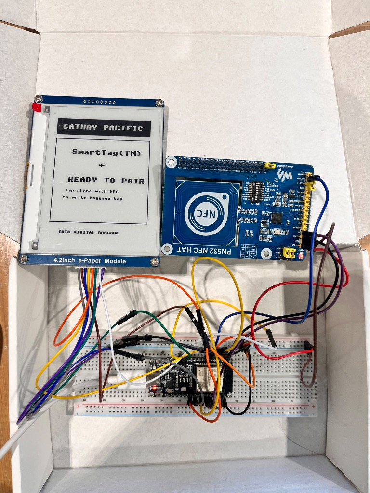
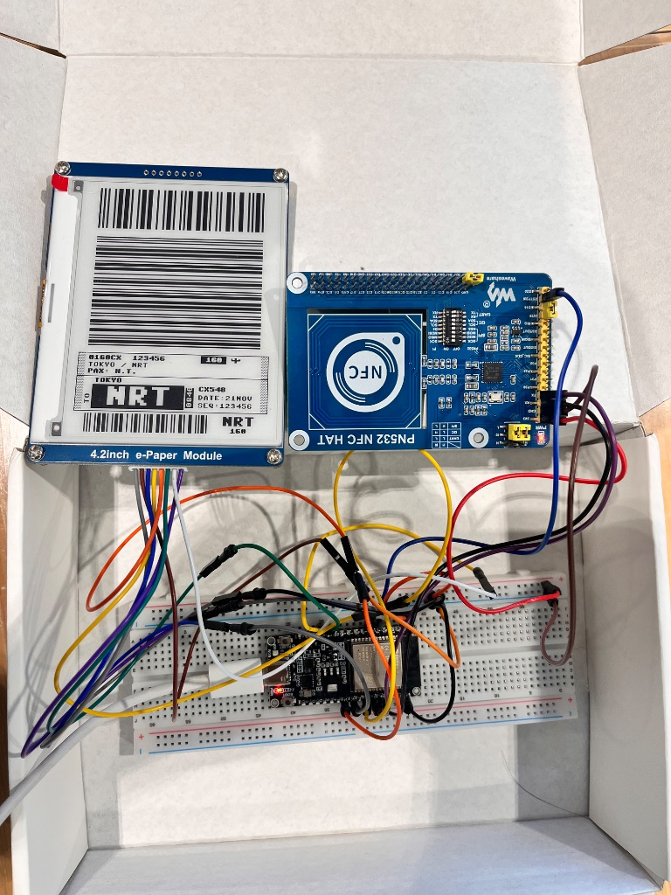

# Baggage Recovery Copilot — Hardware Specification & Prototype

Physical prototype verification for the Cathay Hackathon 2026 digital baggage identity tag.

---

## 1. Prototype Photos

| Standby / Ready to Pair (Cold Reset) | Paired & Rendered Baggage Tag |
| :---: | :---: |
|  |  |
| *Display reset upon power-on / unpair, showing standby prompt for passenger.* | *Real baggage tag rendered after contactless phone NFC tap (CX548 to NRT).* |

---

## 2. Hardware Architecture & Signal Flow

```mermaid
flowchart TD
    subgraph Mobile ["📱 Passenger Smartphone"]
        App["Cathay App (Expo / React Native)"]
        NfcChip["NFC Controller (ISO/IEC 14443-4 Type-A)"]
        App -->|"Tap to Tag (PNR + Flight CX548)"| NfcChip
    end

    subgraph SmartTag ["🏷️ PolyAero SmartTag Physical Prototype"]
        subgraph NFC_Mod ["Waveshare PN532 NFC HAT"]
            Antenna["13.56 MHz NFC Antenna"]
            PN532_IC["PN532 Chip (Card Emulation Mode)"]
            Antenna <--> PN532_IC
        end

        subgraph MCU ["ESP32-C6 Microcontroller (MicroPython Firmware)"]
            Boot["boot.py (Auto-boot execution)"]
            NfcHandler["nfc_handler.py (ISO-DEP / PA1 / NDEF Protocol)"]
            LayoutEngine["layout.py + barcode.py (IATA Layout + ITF-10)"]
            EpdDriver["epaper4in2.py (Waveshare V2 Controller)"]
            Boot --> NfcHandler
            PN532_IC <-->|"HSU UART (115200 bps)"| NfcHandler
            NfcHandler -->|"Baggage Metadata Payload"| LayoutEngine
            LayoutEngine -->|"300x400 1-bit Frame Buffer"| EpdDriver
        end

        subgraph EPD_Mod ["Waveshare 4.2\" E-Paper Module (V2)"]
            EpdDisplay["400x300 Bi-stable E-ink Display"]
            EpdDriver -->|"Hardware SPI + Handshake"| EpdDisplay
        end
    end

    NfcChip <-->|"Near-Field Coupling"| Antenna
    EpdDisplay -.->|"Zero-power persistent image"| BarcodeVisual["IATA Barcode & Passenger Info (NRT)"]
```

---

## 3. Pinout & Interconnection Schematic

### A. ESP32-C6 to Waveshare 4.2" E-Paper Module (SPI)

| E-Paper Pin | Wire Color | ESP32-C6 GPIO | Function | Description |
|:---|:---|:---|:---|:---|
| **VCC** | Red | 3.3V | Power | 3.3V DC Power Supply |
| **GND** | Black / Brown | GND | Ground | Power Ground |
| **DIN** | Blue | GPIO 19 | SPI MOSI | Master Out Slave In data line |
| **CLK** | Yellow | GPIO 21 | SPI SCK | SPI Clock signal (up to 4MHz) |
| **CS** | Orange | GPIO 18 | Chip Select | Active LOW slave select |
| **DC** | Green | GPIO 2 | Data/Command | LOW: Command register, HIGH: Display RAM |
| **RST** | White | GPIO 3 | Reset | Active LOW hardware reset |
| **BUSY** | Purple | GPIO 6 | Busy Status | Active HIGH indicating internal refresh cycle |

### B. ESP32-C6 to Waveshare PN532 NFC HAT (UART)

| PN532 Pin | Wire Color | ESP32-C6 GPIO | Function | Description |
|:---|:---|:---|:---|:---|
| **5V / VCC** | Red | 5V / 3.3V | Power | Power Supply |
| **GND** | Black | GND | Ground | Common Ground |
| **TX** | White / Blue | GPIO 22 | ESP32 RX | UART Serial In from PN532 |
| **RX** | Yellow | GPIO 23 | ESP32 TX | UART Serial Out to PN532 |
| **RSTPDN** | Green | GPIO 7 | Reset/PowerDown | Hardware pulse to wake up / reset PN532 |

### C. PN532 DIP Switch & Jumper Configuration

| Switch / Jumper | Setting | Mode Function |
|:---|:---|:---|
| **SEL0 (Yellow Jumper)** | **L** (Left) | Select High Speed UART (HSU) |
| **SEL1 (Yellow Jumper)** | **L** (Left) | Select High Speed UART (HSU) |
| **UART DIP 1** | **ON** | Connect TX line to header |
| **UART DIP 2** | **ON** | Connect RX line to header |
| **SPI DIP Switches** | **OFF** | Disable SPI bus |
| **I2C DIP Switches** | **OFF** | Disable I2C bus |

---

## 4. Key Firmware Algorithms & Proof of Work

1. **Autonomous Cold Boot**:
   - `boot.py` runs garbage collection and kicks off `main.run()` automatically on power application.
   - Screen renders standard Cathay Pacific standby card (`READY TO PAIR`) so passengers know tag is active.

2. **Contactless NFC APDU Session (`nfc_handler.py`)**:
   - Emulates ISO 7816-4 Type-4A PICC with AID `D2760000850101`.
   - Supports proprietary high-speed PA1 command set (`0x80 0x10` payload, `0x80 0x11` confirmation) with fallback to standard NDEF Type-4A text records.
   - Defers E-ink partial refresh until ISO-DEP readback completes, preventing phone-side timeout disconnects.

3. **IATA 10-Digit Interleaved 2 of 5 Barcode Engine (`barcode.py` + `layout.py`)**:
   - Computes standard IATA 10-digit license plate numbers (e.g. `0160CX 123456`) in Interleaved 2 of 5 (ITF) format.
   - Renders 1-bit black/white bitmap directly in memory with 0-allocation buffers suitable for microcontroller RAM constraints.
